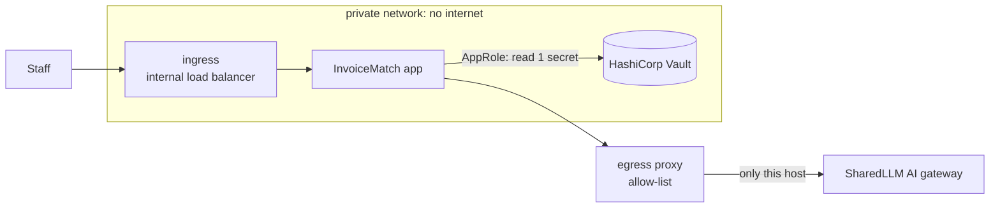

# InvoiceMatch: Deployment in a Customer Environment

[](https://github.com/Umashanker1982/invoicematch-customer-deployment/actions/workflows/customer-environment.yml)

**Lab: Deploy an AI Solution in a Customer Environment** · by **Umashanker**

An existing AI agent, **InvoiceMatch** (AI invoice-to-PO matching, built in Capstone 2: [source](https://github.com/Umashanker1982/invoicematch), [live demo](https://invoicematch.onrender.com)), deployed as a Forward Deployed Engineer into a **simulated customer environment**, treating every constraint as real:

- 🔒 **Isolated private network:** the app has **no internet access**
- 🚪 **One controlled exit:** an egress proxy that allows **only the approved AI gateway**
- 🔑 **HashiCorp Vault** for secrets: the app reads **one** secret with its own least-privilege identity
- 🛡️ **Hardened containers:** non-root, read-only, no Linux capabilities
- ✅ **Proof, not promises:** GitHub Actions deploys the whole environment on every push and runs **22 PASS/FAIL checks** (badge above)

## Verification result (latest run)

```
== 1. The application runs in the customer environment      4 PASS
== 2. Network boundaries                                     6 PASS
== 3. Secrets management (HashiCorp Vault)                   5 PASS
== 4. Least privilege (Vault policy for the app's identity)  4 PASS
== 5. Container hardening                                    3 PASS
ALL CHECKS PASSED
```

See the full list in the latest run under **Actions → Customer environment check → Verify the deployment and its controls**.

## Deliverables

| Deliverable from the brief | Document |
|---|---|
| Deployment architecture diagram | [docs/deployment_architecture.md](docs/deployment_architecture.md) (diagram, components, network boundaries, production mapping, ownership) · [image](docs/architecture.png) |
| IAM design document | [docs/iam_design.md](docs/iam_design.md) |
| Security design summary | [docs/security_design.md](docs/security_design.md) |
| Operational runbook | [docs/runbook.md](docs/runbook.md) |
| Knowledge transfer guide | [docs/knowledge_transfer.md](docs/knowledge_transfer.md) |
| Reusable asset proposal | [docs/reusable_asset.md](docs/reusable_asset.md) |

## Requirements checklist

| # | Requirement | Where it is met |
|---|---|---|
| 1 | Deployment architecture: infrastructure, network boundaries, security controls, ownership | [deployment_architecture.md](docs/deployment_architecture.md) |
| 2 | Deploy within a simulated customer environment | [customer-env/docker-compose.yml](customer-env/docker-compose.yml): private internal network, ingress, egress proxy, Vault; deployed by [CI](.github/workflows/customer-environment.yml) |
| 3 | Least-privilege IAM: roles, permissions, service accounts, policies | [iam_design.md](docs/iam_design.md); [Vault policy](customer-env/vault/policies/invoicematch-app.hcl); checks in section 4 |
| 4 | Secrets management (API keys, credentials, tokens, configuration) | HashiCorp Vault + AppRole: [init.sh](customer-env/vault/init.sh), [vault_entrypoint.py](customer-env/app/vault_entrypoint.py); checks in section 3 |
| 5 | Monitoring and observability requirements | [monitoring.md](docs/monitoring.md); JSON logs from the app, proxy, and Vault audit log |
| 6 | Complete operational runbook | [runbook.md](docs/runbook.md) |
| 7 | Knowledge transfer for customer teams | [knowledge_transfer.md](docs/knowledge_transfer.md) |
| 8 | At least one reusable organizational asset | [reusable_asset.md](docs/reusable_asset.md): the "Customer Environment Kit" |
| Tooling | Simulated private-network environment + a secrets-management tool | Docker networks (`internal: true`) + **HashiCorp Vault 1.17** |

## How it works



1. At start-up the app logs in to Vault with its **AppRole**, reads the AI gateway key into memory, and gives its token back.
2. AI calls leave only through the **egress proxy**, which allows `api.sharedllm.com:443` and refuses and logs everything else.
3. Users reach the app only through the **ingress**; Vault and the app have no published ports.

## Repository map

| Path | What it is |
|---|---|
| [customer-env/docker-compose.yml](customer-env/docker-compose.yml) | The customer environment: networks, services, hardening |
| [customer-env/vault/](customer-env/vault/) | Vault policy and one-time setup (audit log, AppRole, secrets) |
| [customer-env/app/vault_entrypoint.py](customer-env/app/vault_entrypoint.py) | Starts InvoiceMatch with its secret from Vault |
| [customer-env/egress-proxy/](customer-env/egress-proxy/) | Egress allow-list proxy |
| [customer-env/ingress/nginx.conf](customer-env/ingress/nginx.conf) | Internal load balancer |
| [scripts/fetch_app.sh](scripts/fetch_app.sh) | Fetches InvoiceMatch at a pinned, tested commit |
| [scripts/verify_environment.sh](scripts/verify_environment.sh) | The 22 control checks |
| [tests/](tests/) | Unit tests for the proxy and the Vault wrapper |
| [docs/](docs/) | The six deliverable documents + monitoring |

## Run it yourself

Requires Docker (Linux, macOS, or WSL). Full steps are in the [knowledge transfer guide](docs/knowledge_transfer.md#2-getting-started-about-30-minutes-on-a-linux-macos-or-wsl-machine-with-docker):

```bash
cp .env.example .env    # set VAULT_ROOT_TOKEN
bash scripts/fetch_app.sh
docker compose --env-file .env -f customer-env/docker-compose.yml up -d --build
set -a; . ./.env; set +a; bash scripts/verify_environment.sh
```

> Silverbrook Financial is a fictional customer. All data is sample data. Vault runs in dev mode for the simulation; the production equivalents are listed in [security_design.md](docs/security_design.md#known-limits-of-the-simulation-and-the-production-answer).
