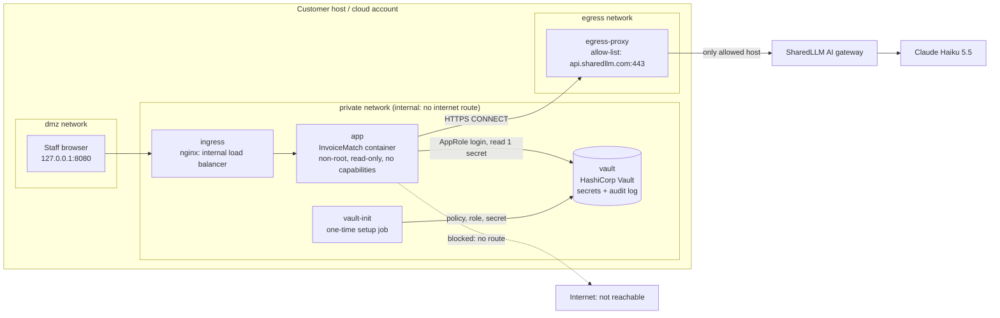

# Deployment architecture

InvoiceMatch is deployed into a **customer-controlled environment**: the customer owns the network, the secrets, and the operations. The vendor ships a container image and configuration; nothing runs in the vendor's cloud.

## Simulated customer environment (this repository)

| Component | Role | Network | Key controls |
|---|---|---|---|
| **ingress** (nginx 1.27) | Internal load balancer: the only published port (`127.0.0.1:8080`) | dmz + private | Body size limit; no server version header |
| **app** (InvoiceMatch, pinned commit `743d96e`) | The AI agent: reads invoices with Claude, rules decide, people approve | private only | Non-root (uid 10001), read-only file system, all Linux capabilities dropped, `no-new-privileges`, no published port |
| **vault** (HashiCorp Vault 1.17) | Secrets store and audit log | private only | No published port; AppRole auth; file audit device |
| **vault-init** | One-time job: policy, AppRole, secrets, credentials | private only | Exits after setup |
| **egress-proxy** (Python, standard library) | The only route to the internet | private + egress | Allow-list of one host; refuses and logs everything else |

(Also as an image: [architecture.png](architecture.png).)

## Network boundaries

| Boundary | Rule | Verified by |
|---|---|---|
| Internet → app | No direct access; only through the ingress | `App port 8000 is not reachable from outside` |
| Internet → Vault | No access at all | `Vault is not reachable from outside the private network` |
| App → internet | No route (`internal: true` network) | `App container has no direct internet access` |
| App → AI gateway | Only through the egress proxy, only `api.sharedllm.com:443` | `Egress proxy allows the approved AI gateway` |
| App → any other host | Refused (HTTP 403) and logged | `Egress proxy refuses hosts not on the allow-list`, `…logged the refused attempt` |

Check names refer to [`scripts/verify_environment.sh`](../scripts/verify_environment.sh), which GitHub Actions runs on every push.

## Mapping to a production customer cloud (AWS example)

| Simulated here | Production equivalent |
|---|---|
| Docker `private` network (`internal: true`) | Private subnets in the customer VPC, with no internet gateway or NAT route for the app |
| `egress-proxy` | Egress proxy or AWS Network Firewall with a domain allow-list |
| `ingress` (nginx) | Internal Application Load Balancer behind company SSO |
| `vault` (dev mode) | HA Vault cluster (or AWS Secrets Manager) with auto-unseal through KMS |
| `vault-init` | Security team's Vault change process (Terraform) |
| AppRole credentials volume | Vault Agent auto-auth or AWS IAM auth (no credentials on disk) |
| `docker compose` | ECS or EKS service, 2+ tasks across 2 availability zones |
| GitHub Actions verification | Same checks run in the customer's pipeline after every deployment |

## Operational ownership

| Area | Owner after handover | Vendor role |
|---|---|---|
| Network, ingress, egress allow-list | Customer platform team | Advises on changes |
| Vault: policies, rotation, audit | Customer InfoSec | None (no vendor access to secrets) |
| App deployment and upgrades | Customer platform team | Supplies tested releases (pinned commits) |
| Business rules and approval limits | AP Manager, with Compliance sign-off | Implements approved changes |
| Incidents | Customer on-call (L1/L2) | L3 support for code issues |

See [knowledge_transfer.md](knowledge_transfer.md) for the RACI and handover plan.
